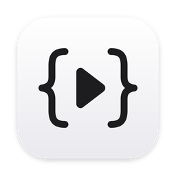

# Easy Edit

一个给临时脚本用的 Mac 小编辑器：打开就写，`Cmd + Enter` 运行，不用起名字，也不用管路径。

- **TypeScript / JavaScript**：在窗口里直接运行，带类型检查、补全、悬停看类型（编辑器内核是 VS Code 的 Monaco）。
- **Python / C++**：调用本机的 `python3` 和 `clang++`（装了 Xcode 命令行工具就有）。报错的行会在编辑器里标出来。
- **草稿**：自动保存，左边的「最近」列表按时间排列，最多保留 50 份。想留下来就 `Cmd + S` 存成文件。

## 安装 / 更新

需要先安装 Xcode 命令行工具：`xcode-select --install`。然后在解压出的文件夹中运行：

```bash
bash setup.sh
```

脚本会：把代码同步到 `~/Developer/Easy-edit`，提交并推送到 GitHub，编译 App，装进「应用程序」并打开。拿到新版本时再运行一次即可。

- 换本地仓库位置：`EASY_EDIT_DIR=/某个路径 bash setup.sh`
- 只提交不推送：`EASY_EDIT_NO_PUSH=1 bash setup.sh`
- 已经在仓库里，只想重新编译：`bash build.sh`，产物在 `build/Easy Edit.app`

## 程序在哪里运行、能访问什么

- 每次运行时，代码会写进 `~/Library/Caches/Easy Edit/run/` 里的临时文件，运行结束就删掉。
- 程序的**工作目录**是 `~/Easy Edit`：脚本里的相对路径（比如 `open("out.txt", "w")`）都落在这里。菜单「文件 › 在 Finder 中打开工作目录」可以直接打开它。
- Python 和 C++ 程序以你的身份运行，权限和在终端里敲 `python3` 一样：能读写你的文件、能联网，但没有管理员权限。第一次访问「桌面」「文稿」「下载」等位置时，macOS 会弹窗请你确认。
- 编辑器界面本身不能访问文件；App 不开任何网络端口。
- 程序没有标准输入，`input()` 和 `std::cin` 会立即读到结尾。

## 快捷键

| 操作 | 快捷键 |
| --- | --- |
| 运行 | `Cmd + Enter` |
| 停止 | `Cmd + .` |
| 新草稿 | `Cmd + N` |
| 存储为文件 | `Cmd + S` |
| 编辑器里的其他快捷键 | 和 VS Code 相同 |

## 目录结构

| 路径 | 内容 |
| --- | --- |
| `app/main.swift` | 原生外壳：窗口、菜单、运行 python3 / clang++ |
| `app/Info.plist`、`app/AppIcon.*` | App 信息和图标 |
| `web/` | 编好的编辑器页面，App 直接加载它 |
| `src/` | 编辑器页面的源码；改界面时用 `npm install && npm run build:app` 重新生成 `web/` |
| `build.sh` | 只编译 App |
| `setup.sh` | 同步、提交、推送、编译、安装 |
